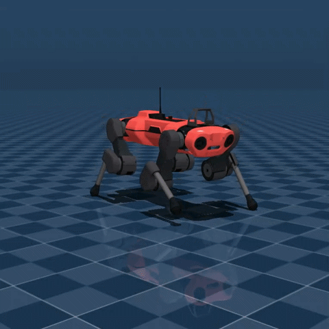
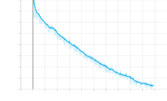
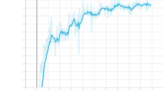
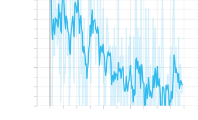
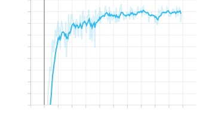
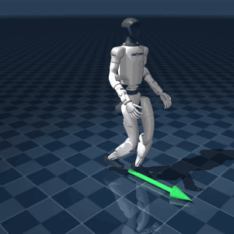

# differential-policies

[](https://www.python.org/)
[](https://github.com/google/jax)
[](https://github.com/google-deepmind/mujoco)

a JAX/MJX reference implementation of [Learning Deployable Locomotion Control via Differentiable Simulation](https://arxiv.org/abs/2404.02887) (Schwarke et al., CoRL 2025).

the original paper uses Warp. this reimplements the core idea in MuJoCo MJX.



---

## the paper in one paragraph

Schwarke et al. train locomotion policies by backpropagating gradients directly through the simulator (SHAC — short-horizon actor-critic). the blocker is that contact solvers use hard complementarity conditions, killing gradients at every foot contact. their fix: replace the hard switch with a sigmoid. this produces smooth, usable gradients and enables direct policy optimization without PPO or reward engineering tricks.

---

## this implementation

the original uses Warp as the differentiable backend. here we use MuJoCo MJX (pure JAX), which makes the whole pipeline, environment, policy, training, a single JAX program.

the contact smoothing patch is a monkey-patch on MJX's `constraint.py`, applied at import time:

```python
active = pos < 0              # original — hard switch, gradient dies at contact
active = sigmoid(-pos * κ)   # patched  — smooth activation, κ = 300
```

three sites are patched: frictionless, pyramidal, and elliptic friction cones.

---

## results

training curves (v9, 20k iterations, 512 envs, single GPU):

<table align="center">
  <tr>
    <td align="center"><br><sub>policy loss</sub></td>
    <td align="center"><br><sub>linear velocity tracking reward</sub></td>
  </tr>
  <tr>
    <td align="center"><br><sub>fraction of NaN gradients</sub></td>
    <td align="center"><br><sub>angular velocity tracking reward</sub></td>
  </tr>
</table>

`lin_vel_tracking` peaks at **0.73** (0 = standing still, 1 = perfect velocity tracking). trains in ~2h on an RTX 3090.

these results are a starting point, not a ceiling. the reward weights were not heavily tuned and training was capped at 20k iterations. longer runs, a learning rate schedule sweep, or tighter reward scaling would likely push tracking performance higher — the policy loss curve is still improving at convergence, which suggests there is headroom left.

one difference from the paper: we use 32-step unrolls where the paper uses 12. on ANYmal, MJX's smoothed gradients had a cosine similarity of **0.374** vs finite differences, and longer unrolls were our way of compensating. that number needs a caveat, though: on the G1 (below), finite differences disagree with *themselves* at long horizons, so a low cosine there says as much about chaos as about the gradient.

### G1: smoothed MJX vs MuJoCo Warp's exact gradient



<sub>the MuJoCo Warp policy (unroll 32, 3 iterations) driven by scripted joystick commands (forward, turn left, strafe, turn right). the green arrow is the commanded path over the next second. run through the deployment controller in CPU MuJoCo with sensor noise and one tick of latency.</sub>

[MuJoCo Warp PR #1535](https://github.com/google-deepmind/mujoco_warp/pull/1535) adds an exact adjoint (implicit function theorem on the constraint solve, no contact smoothing). `bench_grad_g1.py --states-from policy` compares both against central finite differences on states from a walking G1 policy: 8 states, 128 random directions, both simulators at 50 solver iterations (converged), each against its own FD (eps 0.01). cos(FD, FD) is the agreement between FD at eps 0.001 and 0.01, a ceiling on how far FD can be trusted.

| horizon (control steps) | 1 | 4 | 8 | 16 | 32 |
|---|---|---|---|---|---|
| MuJoCo Warp | 1.000 | 1.000 | 1.000 | 0.845 | 0.596 |
| cos(FD, FD) | 1.000 | 1.000 | 0.999 | 0.683 | 0.113 |
| MJX smoothed (κ=300, straight-through) | 0.997 | 0.996 | 0.956 | 0.375 | 0.279 |
| cos(FD, FD) | 0.901 | 0.857 | 0.776 | 0.251 | 0.150 |

with a converged solver the Warp gradient *is* the FD gradient up to 8 control steps (80 physics steps); beyond that both simulators are chaotic enough that FD stops being a reference. at the training setting (3 solver iterations, both simulators) the Warp gradient still reaches 0.985 at 8 steps against MJX's 0.849.

throughput, `bench_throughput_g1.py` (64 envs, RTX 4060 laptop, one SHAC policy update = forward + gradient of the summed reward):

| | unroll 12 | unroll 32 |
|---|---|---|
| MJX smoothed | 743 ms | 1975 ms |
| MuJoCo Warp, 3 iterations | 295 ms | 786 ms |
| MuJoCo Warp, 50 iterations | 374 ms | 959 ms |

MJX needs `jax.checkpoint` on each control step to fit in 8 GB, which adds one forward (~330 ms at unroll 32). Warp's backward is a single linear solve regardless of how many iterations the forward took, so a converged solve costs only ~20% more.

SHAC training, 10k policy updates, same env and rewards, eval episode length out of 1000 (20 s). MJX runs use `--remat` (per-control-step `jax.checkpoint`) to fit in 8 GB:

| | envs | env-steps/s | first eval ≥ 600 | best | last 10 evals |
|---|---|---|---|---|---|
| MJX smoothed, unroll 32 | 64 | ~1,035 | epoch 10 | 989 | 888–976 |
| MuJoCo Warp, unroll 32, 3 iterations | 64 | ~2,400 | epoch 6 | 992 | 806–893 |
| MuJoCo Warp, unroll 32, 50 iterations | 64 | ~2,000 | epoch 9 | 990 | 823–944 |
| MJX smoothed, unroll 16 | 128 | ~1,580 | never | 80 | 69–79 |
| MuJoCo Warp, unroll 16, 3 iterations | 128 | ~4,240 | never | 77 | 68–75 |
| MuJoCo Warp, unroll 12, 3 iterations | 64 | ~2,400 | never | 68 | 62–66 |

at unroll 32 both backends reach the same policy; Warp gets there ~2.3x faster in wall clock (the MJX run took 5 h 50 min). a better gradient does not, by itself, buy back the short unroll: at 16 steps, with the same 2048 samples per update, both backends settle on falling within ~1.5 s.

---

## setup

```bash
git clone https://github.com/saucesaft/differential-policies
cd differential-policies
uv sync --frozen
```

requires a CUDA-capable GPU. JAX with CUDA 13 is pulled in automatically. `--frozen` installs straight from `uv.lock`; without it, uv tries to re-resolve the lock and fails if the optional MuJoCo Warp checkout below is missing.

### MuJoCo Warp backend (optional)

the G1 Warp results need the differentiable MuJoCo Warp from [PR #1535](https://github.com/google-deepmind/mujoco_warp/pull/1535), which isn't released yet. it's installed from a local checkout in `third_party/mujoco_warp` (gitignored): etaoxing's `adjoint` branch at `357a75d`, plus two fixes from rakhimovv that the G1 needs (`c8c8890` skips pyramidal contacts correctly, `4af093f` handles clamped actuator forces). rakhimovv's branch already has both on top of `357a75d`:

```bash
git clone https://github.com/rakhimovv/mujoco_warp.git third_party/mujoco_warp
git -C third_party/mujoco_warp checkout 4af093f
uv sync --group warp
```

to build it from the PR branch instead:

```bash
git clone -b adjoint https://github.com/etaoxing/mujoco_warp.git third_party/mujoco_warp
cd third_party/mujoco_warp
git checkout 357a75d
git remote add rakhimovv https://github.com/rakhimovv/mujoco_warp.git
git fetch rakhimovv
git cherry-pick c8c8890 4af093f
```

then run anything that touches Warp with the group enabled, e.g. `uv run --group warp python train_g1.py --backend mjwarp`.

---

## training

open `anymal.ipynb`. hyperparameters are in the third cell:

| param | value | notes |
|---|---|---|
| `unroll_length` | 32 | covers ~1.3 trot cycles |
| `num_envs` | 512 | |
| `num_training_steps` | 20 000 | |
| `kappa` | 300 | contact smoothing sharpness |

---

## evaluation

```bash
# passive viewer
uv run eval_viewer.py saved_policies/schwarke_stage1_v9.pkl

# interactive — gamepad required (left stick = move, right stick = rotate)
uv run drive.py saved_policies/schwarke_stage1_v9.pkl
```

---

## repo structure

```
envs/
  register_ahac_anymal.py     — ANYmal environment, rewards, PD control
  assets/anybotics_anymal_c/  — MuJoCo XML and meshes
shac/
  train.py                    — SHAC trainer
  losses.py                   — policy and critic losses
  networks.py                 — MLP policy and value networks
smooth_mjx/
  __init__.py                 — contact smoothing patch (the key piece)
eval_viewer.py                — passive viewer
drive.py                      — gamepad controller
anymal.ipynb                  — training notebook
```

---

## acknowledgments

- [Schwarke et al., CoRL 2025](https://arxiv.org/abs/2404.02887) — the paper this implements
- [Andrew-Luo1/jax_shac](https://github.com/Andrew-Luo1/jax_shac) — starting point for the SHAC implementation
- [Brax](https://github.com/google/brax) — batched MJX environment wrappers
